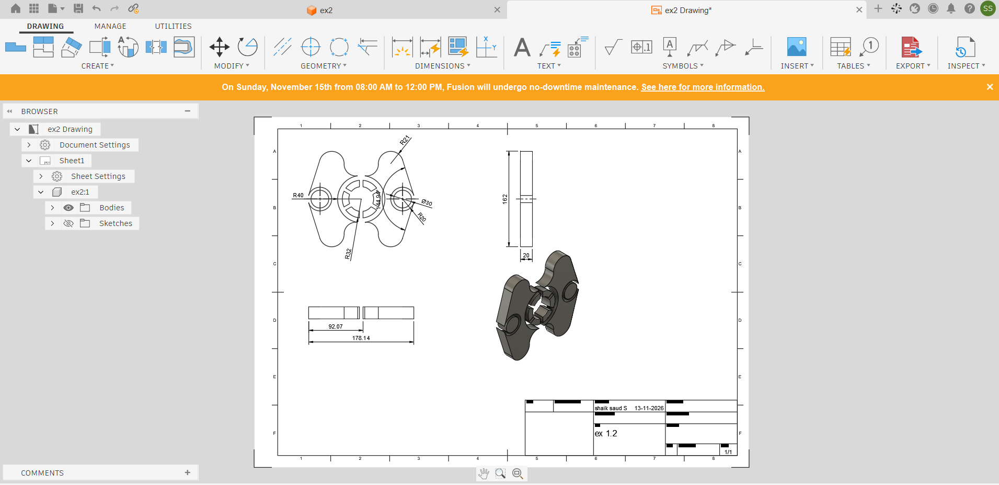

# Smart India Hackathon Workshop
# Date: 15-11-2026
## Reference Number: 26013211
## Name: SHAIK SAUD S

## Problem Title
SIH 26033: Multiple intermediaries reduce farmers earnings and increase consumer prices.

## Problem Creater's Organization
Ministry of Consumer Affairs, Food & Public Distribution

## Theme
Agriculture, FoodTech & Rural Development

## Problem Description
Expected Solution: Create a digital marketplace that:

• Connects farmers/FPOs directly with consumers and bulk buyers.
• Provides logistics support.
• Uses AI for demand forecasting and route optimization.

Benefits:

• Better prices for farmers.
• Lower prices for consumers.
• Reduced supply chain inefficiencies.

## Proposed Solution

1. Develop a mobile application and website with multilanguage (english,tamil,hindi and others with voice support) where farmers directly contact with consumers, retailers, hotels, and supermarkets, reducing the need for multiple middlemen.
2. The platform helps farmers by providing shared transport through village hubs, AI-based quality checking, secure payments, quick settlements, and ratings for farmers and buyers, reducing their need for middlemen.
3. Displays farm-gate prices alongside market prices, helping farmers make informed selling decisions and consumers understand product costs and AI predicts crop prices and demand to help farmers decide what to grow and when to sell. QR codes track products from farm to consumer, while farmer ratings build trust and help good-quality farmers earn higher prices.

## Technical Approach

1. Requirement Analysis: Identify the problems faced by farmers and consumers like price differences, and transportation costs.
2. System Design: Design the website, database structure, and separate dashboards for farmers and buyers.
3. Development: Develop the platform using Python and Django, with features for registration, crop listings, price comparison, ordering, and payments.
4. Database Integration: Store farmer profiles, available crops, product prices, buyer details, and order information in the database.
5. Testing: Test user registration, product searches, order placement, payment processing, and delivery coordination.
6. Deployment and Evaluation: Appoint a person who has a knowledge in the website in  a local village or market, collect feedback, and improve the platform before expanding to other areas.

## Feasibility and Viability
1. Technically Feasible: The platform can be developed using existing web technologies, databases, smartphones, and digital payment systems without requiring expensive infrastructure.
2. Economically Viable: Revenue can be generated through small transaction fees, subscriptions for bulk buyers, or optional delivery services while keeping basic access affordable for farmers.
3. Practical Implementation: Begin with a pilot project in one village or local market, partner with farmer groups and transport providers, and gradually expand based on user feedback and demand.

## Impact and Benefits
1. Increased Farmer Income: Direct connections with buyers can reduce unnecessary commissions and help farmers negotiate better selling prices.
2. Lower Consumer Prices: Fewer intermediaries and efficient transportation can reduce additional costs, making fresh agricultural products more affordable.
3. Transparency and Reduced Waste: Digital records, price comparisons, and demand-based orders can improve trust, reduce unsold produce, and strengthen the agricultural supply chain.

## Research and References
1. National Agriculture Market (e-NAM), Government of India: An existing electronic trading platform that connects agricultural markets and promotes transparent price discovery.
Website: https://enam.gov.in/. 

2. Food and Agriculture Organization (FAO): Digital Technology and Agricultural Markets: Research on how digital platforms and emerging technologies can improve market access and support small farmers.
Website: https://agritechobservatory.review.fao.org/ .

3. Government of India, Electronic National Agricultural Market (e-NAM) Review: A report examining agricultural marketing challenges, including high intermediation costs, limited market access, and lack of price information.
website: https://desagri.gov.in/ .
